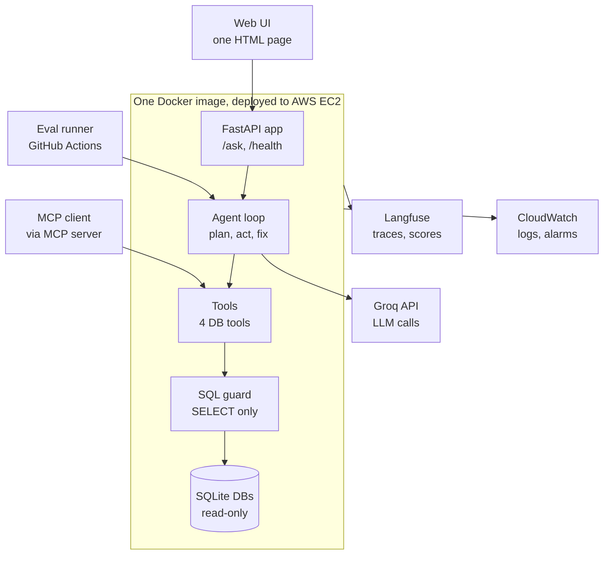

# Data Analyst Agent: Project Plan

## Overview

The agent answers plain-English questions over a SQL database: it explores the schema, writes and runs SQL, fixes its own errors, and returns the answer with the query behind it. One number judges the project: execution accuracy on a fixed 100-question subset of the BIRD Mini-Dev benchmark, meaning the share of questions where the agent's query returns the same rows as the reference query.

Four rules keep it simple:

- One repo, one service, one Docker image. No microservices, queues or Kubernetes.
- The benchmark's SQLite databases ship read-only inside the image, so there is no database server to run.
- The agent loop is hand-written (roughly 150 lines) with no framework. LangGraph comes in Phase 7, as a measured comparison against the hand-written loop.
- Every phase ends with a deployed, working system and a before/after number.

## Architecture

The system is one Python codebase with three ways in and a single path to the data.



The web UI, the eval runner and MCP clients all reach the same tools, so what you measure in CI is what runs in production. The app container sends traces to Langfuse and logs to CloudWatch.

| Layer | Choice | Why this one |
| --- | --- | --- |
| API | Python 3.12, FastAPI, Pydantic | The default stack in AI engineering job posts |
| LLM | Groq behind a thin provider wrapper | Fast inference; the wrapper holds timeouts and retries and lets you swap providers |
| Agent | Hand-written tool-calling loop | You learn what frameworks hide; easy to trace and test; ported to LangGraph in Phase 7 |
| Tools | `list_tables`, `describe_table`, `sample_values`, `run_sql` | Four tools cover exploration and execution; they call a small database interface, never SQLite directly |
| SQL guard | `sqlglot` parse check, SQLite opened read-only, row limit, timeout | Two independent layers: the parser rejects writes, the connection cannot perform them |
| Data | BIRD Mini-Dev SQLite databases | Public, with reference answers, and no server to run; Postgres can be added later as a second adapter |
| Tracing | Langfuse Cloud | OpenTelemetry-based, the common open-source choice |
| Tests | pytest, ruff | Standard |
| CI/CD | GitHub Actions | Tests, builds the image and redeploys |
| Hosting | One EC2 t3.micro running Docker Compose | Real server and Docker practice |
| MCP | Official Python MCP SDK, stdio server | Exposes the same four tools to any MCP client |
| Local dev | uv, Docker Compose | One command to run everything |

### Database interface

The agent and its tools talk to one small interface, and a single adapter file knows it is SQLite. Adding Postgres later means writing a second adapter, with no change to the agent, the tools or their tests.

```python
class Database(Protocol):
    dialect: str                      # "sqlite" now, "postgres" later

    def list_tables(self) -> list[str]: ...
    def describe_table(self, table: str) -> TableInfo: ...
    def sample_values(self, table: str, column: str, n: int = 5) -> list: ...
    def run_query(self, sql: str, row_limit: int, timeout_s: float) -> QueryResult: ...
```

Four things differ between engines, and each stays inside the adapter:

| Concern | SQLite adapter (now) | Postgres adapter (later) |
| --- | --- | --- |
| Schema lookup | `sqlite_master` and `PRAGMA table_info` | `information_schema` |
| Read-only enforcement | File opened in read-only mode | Role with `SELECT` rights only |
| Timeouts | Interrupt from application code | `statement_timeout` |
| Dialect | `sqlite` passed to the prompt and to `sqlglot` | `postgres` passed the same way |

Three rules keep the boundary honest:

1. No `import sqlite3` outside `db/sqlite.py`.
2. No hard-coded dialect in prompts; the prompt reads `dialect` from the adapter.
3. The adapter is chosen from one config value such as `DATABASE_URL`.

Tool tests run against the interface, so a Postgres adapter can reuse them unchanged. The Postgres adapter itself is out of scope until the agent works; when it is added, the eval set needs the PostgreSQL version of the reference queries, which BIRD Mini-Dev provides.

## Phases

Seven core phases plus one optional phase, about eight weeks for the core at roughly eight hours a week (my estimate, adjust to your pace). Each one ends deployed and measured, so you can stop after any phase and still have something to show.

| Phase | Est. weeks | Goal | What you build | Exit check |
| --- | --- | --- | --- | --- |
| 0. Walking skeleton | 1 | Pipeline before features | Repo, CI, tracker, `/health` live on EC2, eval set frozen | A push to `main` deploys; 100 questions committed |
| 1. Baseline | 1 | A first honest number | Single prompt (schema + question to SQL), eval runner, tracing on | Baseline accuracy recorded in the README |
| 2. Agent loop | 1.5 | Explore and self-correct | Four tools, loop with a step cap, retry on SQL errors | Accuracy above baseline; steps and latency recorded |
| 3. Better context | 1.5 | Give the model what it needs | Column descriptions, table selection, value lookup | Accuracy up again; 20 wrong answers analysed in writing |
| 4. Safety | 1 | Nothing harmful gets through | SQL guard, limits, 20 adversarial tests, rate limiting | All adversarial tests pass; accuracy unchanged |
| 5. Cost and latency | 1 | Same quality, fewer tokens | Token budget, schema caching, cheaper model for easy steps, alarms | Tokens per question and p95 latency down, accuracy within 2 points |
| 6. Ship | 1 | Usable by a stranger | Web UI, MCP server, README with results table, failure gallery, demo GIF | Live URL works; one command runs it locally; `v1.0` tagged |
| 7. LangGraph port (optional) | 1.5 | Framework experience, measured | The same agent rebuilt as a LangGraph graph, adding checkpointing and a human approval step before long-running queries | Both versions run the same eval set; accuracy, latency and lines of code compared in the README |

Most of the accuracy gain comes from Phases 2 and 3. If time runs short, cut Phase 5 first.

## Project tracking

Tracking lives in GitHub, next to the code, so the history itself is part of the showcase.

- **Board:** one GitHub Project with four columns: Backlog, This phase, In progress, Done. Keep at most one card in progress.
- **Milestones:** one per phase. Each task is an issue small enough for one sitting of two to three hours.
- **Branches and PRs:** one branch and one PR per issue, named `phase-N/short-name`. The PR template asks four things: what changed, metric before and after, link to the eval result, and the trade-off.
- **Experiment notes:** every change that moves a metric gets a short file in `docs/experiments/` covering problem, change, result, surprise and decision.
- **Decision records:** one short file in `docs/decisions/` per significant choice, such as why there is no agent framework.
- **Weekly review:** fifteen minutes to update the README results table, close the week's cards and pick the next three issues.

A task is done when its tests pass, the eval smoke run passes, it is deployed, and its note is written. New ideas go to Backlog, never into the current phase.

## Tests and evals

Tests check that the code does what you wrote; evals check that the agent gets answers right. They run at different times because evals spend rate-limited LLM calls.

| Layer | What it checks | Runs | LLM calls |
| --- | --- | --- | --- |
| Unit tests | SQL guard, each tool, result comparison, prompt builders | Every push | None |
| Integration tests | Agent loop driven by a scripted fake LLM; API endpoints | Every push | None |
| Safety tests | 20 adversarial inputs: write attempts, instructions hidden in data, runaway queries | Every push | None at guard level |
| Eval smoke | 20 fixed questions, a subset of the test set | Every PR | About 100 |
| Full eval | All 100 test questions | Merge to `main`, or on demand | About 500 |

**The eval set.** [BIRD Mini-Dev](https://github.com/bird-bench/mini_dev) has 500 question and SQL pairs over 11 SQLite databases, licensed CC BY-SA 4.0, so credit it in the README. The project uses the 2026 revision of the questions, published on [Hugging Face](https://huggingface.co/datasets/birdsql/bird_mini_dev), and four of the smaller databases: `formula_1`, `student_club`, `superhero` and `thrombosis_prediction`. The sets were sampled once with a fixed seed and are committed in `evals/data/` as files that never change:

- A 100-question test set, 25 per database. This produces the numbers you publish.
- A 30-question dev set for prompt iteration and failure analysis, so you never tune on the test set.
- A 20-question smoke set, 5 per database, drawn from the test set. It is a regression check only, never used for tuning.

The sets are balanced across databases, not difficulty: in the 2026 revision 460 of the 500 questions are labelled challenging (94 of the 100 test questions), so a difficulty balance is not possible. The reasoning is in `docs/decisions/0001-eval-set.md`.

**Metrics.** Execution accuracy is the headline. Alongside it, record valid-SQL rate, average steps, tokens per question, and p50 and p95 latency, each split by database.

**Reading results.** With 100 questions, a difference under about 5 points is within noise, so confirm small gains with a second run. Run at temperature 0 and record the model name with every result.

**CI rules.** The PR check fails if the smoke run drops by more than two questions against `main`. Results are committed as JSON in `evals/results/` with the commit hash, and the README results table is built from them.

**Failure analysis.** After each full run, tag every wrong dev-set answer with one cause: wrong table, wrong join, wrong filter value, misread question, or ambiguous question. The largest group decides the next task.

## Monitoring and observability

Monitoring answers three questions: is it up, is it right, and what does it cost. Tracing goes in during Phase 1, because an agent is very hard to debug without it.

| Question | Tool | What you capture | Alert |
| --- | --- | --- | --- |
| What did the agent do? | Langfuse traces | One trace per question; a span per LLM call and tool call with prompt, SQL, tokens, latency and model | None |
| Is it right in production? | Langfuse scores | Thumbs up or down from the UI; ten traces reviewed weekly, bad ones added to the dev set | None |
| Is it up? | CloudWatch metrics (EC2 built-in, plus a log metric filter) | CPU, status checks, error count from logs | Email on a failed status check or when errors appear |
| What went wrong? | CloudWatch Logs | JSON log lines carrying the trace ID; 14-day retention | None |
| What does it cost? | AWS Budgets | Monthly spend | Email at 50% and 100% of the monthly budget |

Every log line and every trace share one ID, so you can go from a CloudWatch error straight to the Langfuse trace that explains it.

## Production on AWS EC2

Production runs on AWS EC2: one t3.micro instance running Docker Compose.

**Deployment layout.**

- **Instance:** one t3.micro (1 GB memory) on Ubuntu with Docker and a swap file.
- **Containers:** Docker Compose runs two: the app, and Caddy as the reverse proxy that provides HTTPS.
- **Image:** built in GitHub Actions and pushed to GitHub Container Registry.
- **Data:** the SQLite files are baked into the image and opened read-only.
- **Secrets:** Groq and Langfuse keys sit in a `.env` file on the instance, never in the image or the repo.
- **Deploy:** on merge to `main`, GitHub Actions assumes an IAM role through OIDC and uses SSM Run Command to pull the new image and restart Compose. No SSH keys, and port 22 stays closed.
- **Network:** the security group opens ports 80 and 443 only.
- **Logs:** Docker's `awslogs` driver ships container logs to CloudWatch Logs.

**Guardrails.**

- A monthly AWS budget alert sent to an inbox you read.
- A shared demo code required in a request header, so strangers cannot use up the daily LLM quota.

## Risks and first steps

The main risk is the LLM rate limit, and the plan is shaped around it.

| Risk | What to do about it |
| --- | --- |
| Groq's rate limits allow about 30 requests a minute and 1,000 a day ([third-party tracker](https://costbench.com/software/llm-api-providers/groq/free-plan/); confirm in your Groq console) | Throttle the eval runner, cache results per question and commit, run the full eval at most once a day |
| Tuning prompts until the test set looks good | Iterate only on the dev set; touch the test set for reported numbers only |
| Scope creep | No framework before Phase 7; no vector database or second service until a measured number calls for it |
| The model is changed or retired | Keep the model name in config, record it with every result, rerun the baseline after any change |
| The 1 GB instance runs out of memory | Add a swap file, run one app worker, keep to three or four small databases |

This week, for Phase 0:

- [x] Create the public repo with uv, ruff, pytest and a CI workflow
- [ ] Create the GitHub Project board and eight milestones
- [x] Download Mini-Dev (SQLite), pick the databases, sample and commit the test, dev and smoke sets
- [ ] Set a monthly AWS budget alert
- [ ] Deploy a `/health` endpoint to EC2 with Docker Compose from GitHub Actions
- [ ] Sign up for Groq and Langfuse and store the keys as GitHub secrets

## Sources

- [BIRD Mini-Dev repository](https://github.com/bird-bench/mini_dev)
- [Groq rate limits, CostBench](https://costbench.com/software/llm-api-providers/groq/free-plan/)
